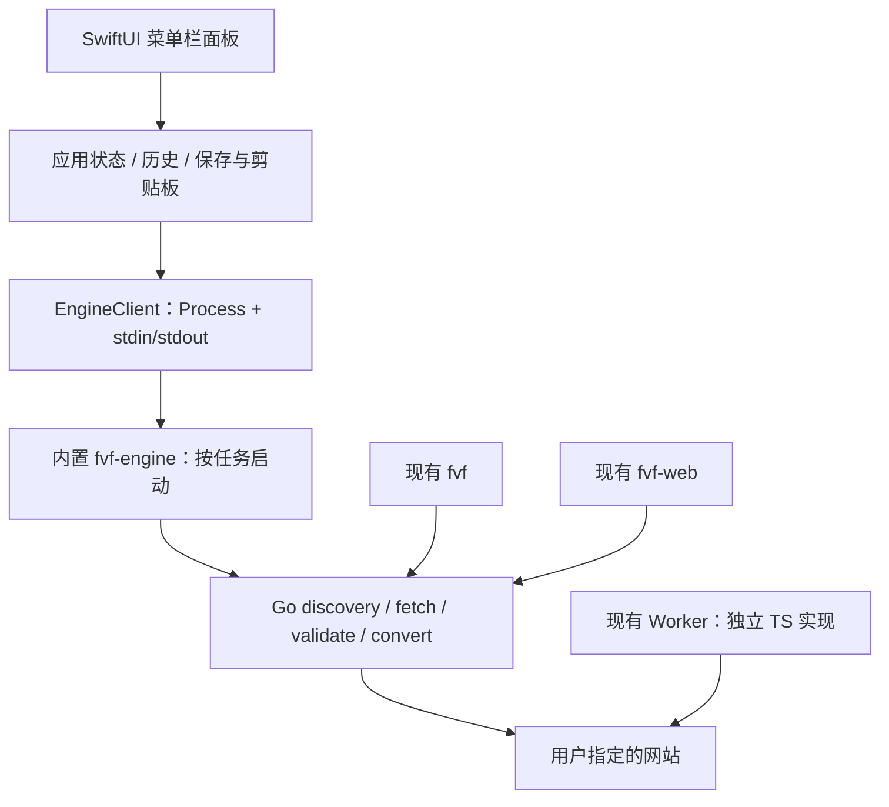

# favicon-fisher：项目审计与 macOS 菜单栏应用方案

> 实施更新（2026-10-18）：首版采用免费 ad-hoc 签名与自建 Homebrew tap，Developer ID 和 Apple 公证为可选项。以下保留初始设计背景；当前发布步骤以 [macOS 文档](macos.md#public-release) 为准。

日期：2026-10-18。审计基线：`9c525bf`。本文保留初始设计与审计记录；后续已开始实现，实际构建和发布状态见 [macOS 文档](./macos.md)。

## 1. 结论

建议新增 **Favicon Fisher.app：SwiftUI 原生菜单栏界面 + 应用内置 Go helper + Homebrew Cask 分发**。

产品定位：在菜单栏粘贴一个网址，查看候选图标，复制图片、保存文件或拖到其他应用。主要流程在一个小面板内完成。

Cask 是安装与升级机制；需要先构建真正的 `.app`。现有 Darwin 二进制不能直接提供菜单栏体验。

默认由本机直接访问目标网站，不依赖线上 Worker，不要求用户安装 Go、Node 或现有 CLI。网站抓取仍需要网络，不能称为离线工具。Worker 保持独立 Web 产品；云端抓取模式留作后续显式选项。

## 2. 当前项目的实际结构

| 形态 | 入口 | 工作方式 | 桌面版可复用内容 |
| --- | --- | --- | --- |
| CLI `fvf` | `cmd/fvf/main.go` | 发现、排序、下载最佳或全部候选；支持代理及 JSON 结果 | Go 抓取、安全和下载代码；终端交互不复用 |
| Go Web `fvf-web` | `cmd/fvf-web/main.go`、`internal/web/` | 内嵌静态页面，提供 preview、proxy、download | 业务流程与 DTO 设计；HTTP 服务不是桌面版必要组件 |
| Cloudflare Worker | `worker/src/`、`worker/public/` | TS 实现发现及代理；浏览器完成格式转换 | 测试 fixtures、产品交互经验、可选未来云端入口 |
| 共同契约 | `testdata/golden/` | Go、Worker 检查部分发现规则 | 新桌面 helper 继续使用同一 Go 核心及 fixtures |
| 发布 | `.github/workflows/release.yml` | Linux/macOS/Windows、amd64/arm64 的 CLI 与 Web 二进制压缩包 | tag、校验和、Release 流程 |

Go 和 Worker 是两套业务实现，不是客户端和统一服务端。Go 的 HTML parser 与 Worker 的正则解析、DNS 防护、格式转换能力不同；桌面端不应再复制第三套发现和排序规则。

现有代码值得复用的基础包括：HTML/Manifest 发现、候选排序、下载失败后尝试下一候选、避免文件覆盖、响应体与候选数量限制、Go 拨号时校验 DNS、签名代理以及 golden fixtures。

仓库里的 `REVIEW.md` 是较早版本的审计。公开默认签名密钥、Go 前端直接加载远端图标、部分无界处理、同名覆盖和最佳候选失败不回退等问题已有修复，不能把旧报告直接当作当前问题清单。

## 3. 本次审计发现

这是核心路径代码审计与本地验证，不是生产环境渗透测试，也未核验 Cloudflare 实际部署版本或配置。

### A. 应优先修复的现有问题

| 优先级 | 问题与证据 | 影响与建议 |
| --- | --- | --- |
| P1 | `worker/src/security/url.ts:16,59`：`URL.hostname` 对 IPv6 保留方括号，后续却按无括号字符串判断；本地执行原校验函数，`[::1]`、`[fd00::1]`、`[fe80::1]`、IPv4-mapped loopback 均被放行 | 应用层私网拦截失效；实际网络可达性仍受 Cloudflare 出口限制，未证明可利用的生产 SSRF。应解析规范化 IP 并按 CIDR 分类，覆盖映射地址，不能只去掉括号后继续做字符串前缀比较 |
| P2 | `internal/web/dto.go:58` 宣称 WebP 可转 PNG/JPG；`internal/convert/convert.go:14` 只注册 GIF/JPEG/PNG 解码器 | 有效 WebP 进入 `image.DecodeConfig` 也缺少对应解码器。补充明确的 WebP 解码支持，或停止宣称该能力；桌面版不能直接照抄当前 allowed_types |
| P2 | `internal/fetcher/download.go` 只校验 HTTP 成功及大小，再写文件；`Fetch` 把下载成功当作图标成功 | 返回 200 的 HTML 错误页会被保存并阻止回退。应在接受最佳结果前验证实际格式，位图检查尺寸并验证解码，失败继续下一候选 |
| P2 | `internal/fetcher/fetcher.go:146` 串行执行最多 12 次类型探测，每个可有 HEAD/GET；`internal/security/ssrf.go:75` 用 `context.Background()` 做预检 DNS | 单次请求 15 秒不代表整项任务 15 秒，取消也无法覆盖该 DNS 预检。增加任务 deadline、传播 context、有限并发及分阶段结果 |
| P2 | `worker/src/routes/preview.ts:88` 在过滤不可展示候选前选择 recommended | 推荐 URL 可能不在返回 icons 中，与 `docs/api.md` 契约不符。应从最终候选中选择，明确“排序推荐”与“已验证可用”的区别 |

### B. 引入桌面版前必须厘清的接口边界

- **`fvf --json` 仍然下载文件**：`cmd/fvf/main.go:92` 先执行 `Fetch`，之后才输出 JSON。它适合自动化下载，不适合菜单栏候选预览。
- CLI 默认使用 `CLIPolicy`，允许私网访问；桌面应用应明确自己的策略，默认使用 `DefaultPolicy`。后续若支持局域网站点，应显式启用且限制到目标范围，不能因复用 CLI 而隐式放开。
- `fvf-web` 当前绑定 `:8080`，即所有接口，不是仅 localhost。直接作为桌面后台启动会引入端口冲突、局域网暴露和进程清理问题。
- Go SVG/ICO 目前主要支持原格式直通，不等于任意图片都能转 SVG/ICO；Worker 的 WebP/ICO 转换在浏览器中，也不是能直接调用的远端转换 API。
- SVG 的当前识别函数不是内容清洗器。原文件可以另存，但不能直接当作可信 HTML/脚本内容展示。
- 现有发布缺少 `.app`、图标资源、Info.plist、macOS 签名、公证、DMG 和 Cask。

### C. 验证结果

- `go test ./...`：通过；使用 Go 1.27.2，依赖及构建缓存定向到 `/private/tmp`。
- `go vet ./...`：通过。
- Worker `npm ci`、`npm run check`、`npm run build`、`npm run test:golden`：通过。
- Worker `npm test`：2 个测试文件、14 个测试通过。Wrangler 写用户目录日志被沙箱拒绝；测试本身通过，退出码为 0。
- IPv6 问题：用 Node 24 的 TypeScript 类型擦除功能加载仓库原校验函数，在不发网络请求的情况下复现。IPv4 loopback 被拦截，上述 IPv6 地址放行。
- 未执行完整 CI 中的 race、fuzz、govulncheck、CodeQL、容器检查；未验证 macOS 签名或安装包。测试通过不代表上述未覆盖路径正确。

## 4. 菜单栏产品设计

### 主流程

点击菜单栏图标 → 粘贴网址或域名 → 回车抓取 → 查看推荐与候选 → 复制图片 / 保存 / 拖出文件。

建议面板宽约 380–420 pt，高度随状态变化，最大约 560 pt 后滚动。状态保存在应用模型中，关闭面板再打开不丢结果。

```text
┌──────────────────────────────────────┐
│ Favicon Fisher                    ⚙  │
│ [ 粘贴网址或输入域名             ]   │
│ [粘贴并抓取]                 [抓取]  │
├──────────────────────────────────────┤
│             ┌──────────┐             │
│             │ 图标预览 │             │
│             └──────────┘             │
│ example.com        PNG · 256 × 256    │
│ 推荐 · 已验证可用                    │
│                                      │
│ [候选1] [候选2] [候选3] [更多…]      │
│ 格式 [PNG ▾]                         │
│ [复制图片]             [保存…]       │
│ 拖动预览图可导出文件                 │
├──────────────────────────────────────┤
│ 最近使用                        查看 │
│ example.com                          │
│ 关于 · 设置 · 退出                   │
└──────────────────────────────────────┘
```

视觉使用系统字体、系统强调色、原生控件及浅色/深色模式。图标预览有棋盘格，以及浅色/深色底切换，方便判断透明图标是否适合使用。菜单栏使用单色 template 图标，优先辨识度；抓取时显示轻量进度状态。

### 交互规则

| 状态 | 行为 |
| --- | --- |
| 空闲 | 焦点在输入框；仅用户粘贴或点击“粘贴并抓取”时读取剪贴板 |
| 抓取中 | 显示“正在读取网页 / 查找图标 / 验证预览”，支持取消；未知耗时不显示虚假百分比 |
| 有结果 | 展示真实解码尺寸与格式；页面声明尺寸另作来源信息，不能当作实测值 |
| 候选失败 | 单个卡片标记失败，自动尝试下一候选；不让一个坏链接清空所有结果 |
| 超时或无网络 | 保留输入和上次结果，提供重试；不自动改走云端 |
| 不支持预览 | 展示格式占位图，可保存经过格式校验的原文件；禁用无法兑现的复制/转换功能 |
| 保存成功 | 短暂显示反馈和“在 Finder 中显示”；不弹出多余对话框 |

保存使用 `NSSavePanel`；复制图片写入实际 PNG/TIFF 数据，另提供“复制来源链接”；拖出使用实际临时文件或文件承诺（file promise），并保证拖拽结束前缓存不被清理。

首版包含应用内快捷键：回车抓取、Esc 关闭、⌘V 粘贴、在合适焦点下 ⌘C 复制图标。全局唤出快捷键放在第二阶段，与 AppKit 面板控制一起实现和验证。

“登录时启动”默认关闭，用户在设置中开启；通过 `SMAppService.mainApp` 管理并读取系统实际状态。提供清晰的退出入口。

## 5. 技术路线与复用方式

| 路线 | 适配成本 | 判断 |
| --- | --- | --- |
| SwiftUI + Go helper | 新增原生 UI、进程协议与 macOS 打包 | **推荐**：贴合菜单栏使用，复用已有 Go 核心 |
| SwiftUI + Go C ABI | 需处理 cgo、内存所有权、回调及跨语言调试 | 可后续评估；当前小工具无需优先承担此成本 |
| WebView/Tauri/Wails | 可复用部分 Web UI，但仍需处理托盘、原生文件/剪贴板与后台生命周期 | 如未来明确做跨平台桌面，再重新比较 |
| 纯 Swift 重写 | 单语言原生集成方便，但形成第三套发现、安全和排序实现 | 当前不推荐 |
| 仅接线上 Worker | 初始接入简单，但依赖网络服务、限流及远端处理用户 URL | 不作为默认执行方式 |

### 建议架构



建议首版最低 macOS 14，构建 Universal 2（arm64 + x86_64）。这是项目支持策略建议，不是 MenuBarExtra 的最低 API 要求；最终需核验使用的 Go/Xcode 工具链与最低系统兼容性。

界面使用 `MenuBarExtra` 的 `.window` 样式及 `LSUIElement=true`，设置界面单独开窗。若后续要求全局快捷键、固定面板或更精确的拖拽生命周期控制，可改由 `NSStatusItem + NSPopover/NSPanel` 承载同一套 SwiftUI 内容。

首版选择 Developer ID 站外分发及 Hardened Runtime，不以 Mac App Store 上架为目标。App Sandbox 是独立工程决策，不能等同于签名/公证；如后续开启，需要补齐 helper 继承、网络与文件授权测试。

### Go helper：新增机器接口，不解析终端输出

建议新增 `cmd/fvf-engine`，仍在当前 Go module 内，直接调用 `internal/` 包；无需为了 Swift 接入就把所有代码迁到公开 `pkg/`。

新增 `internal/engine` 服务层，把发现、读取候选字节、验证和导出组织成可测试的操作。当前 HTTP handler 中的抓取/转换逻辑逐步移入该层；HTTP 签名、限流继续留在 Web 边界。

第一版采用**每个操作一个短生命周期子进程**，通过 stdin 传一个 JSON 请求，stdout 返回一个 JSON 结果，stderr 输出诊断日志。不启动常驻 HTTP 服务，不要求 privileged helper、LaunchDaemon 或管理员权限。

```json
{"protocol_version":1,"id":"req-1","op":"discover","url":"https://example.com","timeout_ms":15000}
```

```json
{"protocol_version":1,"id":"req-1","ok":true,"result":{"page_url":"https://example.com/","candidates":[{"id":"candidate-1","url":"https://example.com/favicon.png","declared_sizes":"256x256","source":"icon"}]}}
```

这些是拟定协议示例，不是已有接口。候选 ID 只用于当前任务关联，不是授权凭证，也不能代替每次网络请求的 URL 校验。

| 操作 | 职责 |
| --- | --- |
| `capabilities` | 返回协议版本、引擎版本、实际支持的源格式与导出格式 |
| `discover` | 仅发现与排序，返回候选和声明元数据，不写用户下载目录 |
| `fetch` | 按策略抓取指定候选，检查大小、真实格式和尺寸，在本次缓存目录输出源文件及可用缩略图 |
| `export` | 从本应用缓存的已验证源文件生成目标格式，返回临时产物；最终写入用户选择位置由 Swift 完成 |

大图通过临时文件传递，不塞进 JSON/Base64。每个任务由 Swift 创建权限为 0700 的独立缓存目录；helper 只在其中写产物。返回相对路径，Swift 校验路径仍在该目录内并拒绝符号链接逃逸。禁止以输入网址拼接 shell 命令，使用 `Process.executableURL` 和独立参数。

Swift 同时读取 stdout/stderr，限制协议报文大小，避免 pipe 阻塞。失败统一返回 `INVALID_URL`、`NETWORK_TIMEOUT`、`NO_VALID_ICON`、`UNSUPPORTED_FORMAT`、`CANCELLED` 等机器错误码；用户界面负责中文/英文友好文案。

一个 discover 任务 + 最多 3 个并发候选抓取；只优先加载推荐与可见候选，避免立即下载全部 48 个候选。发现先返回结果，实际探测与验证按需进行。

### 超时、取消、休眠与资源管理

- 阶段预算建议：发现 15 秒；单图抓取 10 秒；前台一次完整操作上限 30 秒。均作为待实测调整的产品参数。
- deadline 必须传到 DNS、HTTP、重定向、manifest 和探测；同时设 UI 侧进程 watchdog。
- 取消时结束对应子进程，短暂宽限后强制终止并回收；进程终止是第一版最终兜底，不假设 Go 转换函数天然响应 context。
- 新任务递增 generation ID，旧结果不能覆盖新网址的结果。面板关闭不等于退出；应用退出时回收全部 helper。
- helper 在读完唯一 stdin 请求后继续监视父进程管道 EOF，并结合自身 deadline，避免 UI 崩溃后长期孤儿进程。
- 唤醒后校验未完成任务状态；失效请求明确重试。空闲期间无轮询、无后台抓取，helper 全部退出。

### 网络与隐私

默认直接连接目标网站，沿用 Go 公网安全策略。首版显式关闭 helper 对不受控代理环境变量的自动继承；HTTP 代理支持作为明确设置后续加入。使用代理时 DNS 可能由代理解析，需单独说明安全边界，不能沿用直连的拨号校验保证。

不后台监听剪贴板、不读取浏览器历史、不默认上传 URL 到 Worker。历史仅在本机保存，建议最近 20 条并可关闭/清空；用户主动抓取后的历史不保存 fragment，查询参数默认剔除。原始 URL 只保留在当前任务内，以兼顾带查询页面的正确抓取。日志同样不记录完整查询参数。

缓存放 `~/Library/Caches/dev.chius.favicon-fisher/`，建议上限 100 MiB、7 天淘汰；历史放应用自己的 Application Support 目录。缓存阈值是设计值，需实测。用户导出的文件不属于缓存和卸载清理范围。

## 6. 首版格式能力与功能范围

先做真实可靠的能力，不照搬 Worker 的格式下拉菜单。

| 源格式 | 首版预览 | 首版导出 |
| --- | --- | --- |
| PNG / JPEG | 原生缩略图 | 原文件、PNG、JPEG |
| GIF | 首帧，明确动画不会保留到 PNG/JPEG | 原文件、首帧 PNG/JPEG |
| WebP | 补齐 Go WebP 解码并通过 fixtures 后启用 | 原文件、PNG、JPEG；不承诺 WebP 编码 |
| ICO | 使用 ImageIO 读取受尺寸限制的帧，解码失败显示占位 | 原 ICO；ICO → PNG/JPEG 暂缓到后续统一转换支持 |
| SVG | 首版显示格式占位，避免不受控外部资源加载 | 校验后保存原 SVG；SVG 渲染、转 PNG 留到下一阶段 |

所有可复制图片必须有已验证的位图；SVG 或不可解码 ICO 仅提供文件/链接操作。JPEG 明确使用白底；PNG 保留透明度。现有 magic-byte 检查还需加完整解码/结构验证，不能把嗅探当作安全清洗。

**首版交付：** 菜单栏、输入/粘贴、候选列表、可靠预览、复制图片、保存与拖出、最近记录、登录启动开关、取消与错误状态、原生深浅色、签名安装包和 Cask。

**后续版本：** 全局快捷键、固定面板、SVG 安全栅格化、多尺寸 ICO 生成、尺寸预设、批量网址、代理设置、Shortcuts/App Intents、应用内更新。云端模式只有明确需求时再加入，并在发请求前让用户知道 URL 将传给所选服务。

## 7. 仓库组织

```text
cmd/fvf/                         # 保留 CLI 入口
cmd/fvf-web/                     # 保留 Web 入口
cmd/fvf-engine/                  # 新增桌面机器接口
internal/engine/                 # 新增编排与协议 DTO
internal/fetcher/                # 复用并改善取消/验证边界
internal/convert/                # 补齐实际格式能力
macos/FaviconFisher.xcodeproj/   # macOS app target
macos/FaviconFisher/             # SwiftUI / EngineClient / HistoryStore
macos/FaviconFisherTests/        # 协议、状态与生命周期测试
scripts/package-macos.sh         # 构建、打包、签名、公证
.github/workflows/release.yml   # 接入 macOS 发布 job
```

Cask 使用已有的 `chius-me/homebrew-tap` 仓库（已核验：默认分支 main，包含 Casks 目录）。应用 bundle ID 为 `dev.chius.favicon-fisher`。

## 8. 签名、安装、升级与 Cask

应用包包含主程序和 `Contents/Helpers/fvf-engine`。Swift 主程序和 Go helper 都提供 arm64/x86_64 架构，合并 Universal 2 后再签名，不能签名后修改二进制。

发布顺序：

1. 现有 Go/Worker verify 门禁 + 新增 macOS 协议和构建测试。
2. macOS runner 构建两个架构的 app/helper，检查版本一致。
3. 使用 Developer ID Application 先签内部 helper，再签外层 app；启用 Hardened Runtime 和 secure timestamp，验证嵌套签名。
4. 制作 DMG，按 Apple 流程签名并提交 `notarytool`，确认 Accepted，再 staple/validate。
5. 在干净环境验证 Gatekeeper、首次打开、helper 启动、网络抓取、保存与退出。
6. 生成最终公证产物 SHA-256，发布固定版本 GitHub Release，并附对应源码和许可证。
7. 更新自有 tap 的 Cask 版本、URL、SHA-256；执行 Cask 审计及安装/升级/卸载检查。

完整用户安装目标如下；这些命令需应用和 tap 发布后才可使用：

```bash
brew tap chius-me/tap
brew install --cask favicon-fisher
brew upgrade --cask favicon-fisher
```

Cask 使用 `app "Favicon Fisher.app"`，显式声明最低 macOS、固定版本 URL、SHA-256、`uninstall quit:` 和仅针对应用自身目录的 `zap`。普通卸载保留历史，显式 `--zap` 清理偏好与缓存；不得删除用户下载目录里的图标。首版不通过 Cask 注册后台服务，也不默认把内置 helper 链接成全局 `fvf`。

首版由 Homebrew 管升级，直接下载安装包的用户手动更新；设置中提供版本与 Release 链接。后续再评估 Sparkle，并协调 Homebrew 与应用内更新的归属。

首个本地原型可以没有开发者证书；面向普通用户的正常安装体验，需要可用的 Developer ID 签名、公证凭据和发布权限。这是发布阶段依赖，不阻塞 UI/引擎开发。CI 凭据使用受保护 secrets 与临时 keychain。

项目沿用现有 GPL-3.0 标识，发布时保留 LICENSE 并提供与二进制对应的源码。正式发布前核对所引入依赖的许可证兼容性。

## 9. 实施顺序与验收

| 阶段 | 工作 | 验收 |
| --- | --- | --- |
| 0：核心修正 | IPv6 校验、格式能力、无效图标回退、context/deadline、推荐契约 | 针对缺陷的回归测试；现有 CLI/Web 不退化 |
| 1：纵向原型 | helper 协议 + 菜单栏输入 + PNG 预览 + 保存 | 无需单独安装 CLI；能从菜单栏完成一次真实网站抓取 |
| 2：可用首版 | 候选切换、复制、拖出、历史、设置、取消、错误、ICO/GIF/WebP 策略 | 核心流程只在菜单栏面板内完成；退出无残留 helper |
| 3：发布 | 双架构、签名、公证、DMG、Cask、安装升级卸载测试 | 干净 Mac 默认 Gatekeeper 设置下可安装运行；Cask 升级可用 |

粗略工作量：熟悉 Swift/Go 的单人约 8–12 个有效工作日，包含修复和安装验证；不含开发者账号、证书或外部公证排队。此估算未做原型验证，SVG 渲染与批量处理不计入首版。

必须验证的场景：裸域名、重定向、相对 manifest、404 首选回退、200 HTML 假图标、恶意尺寸、私网 IPv4/IPv6、超时取消、重复快速提交、睡眠唤醒、面板失焦后保存/拖拽、多显示器、两种 CPU 架构、升级后的登录启动设置，以及清理缓存不影响已导出文件。

优先优化目标是交互响应、可取消和空闲资源占用；真实网站完成耗时受网络影响。性能验收用固定 fixtures 和网络条件量测，再决定启动时间、常驻内存等具体门槛，不把未测量数字写成产品承诺。

## 10. 参考依据

- Apple [MenuBarExtra](https://developer.apple.com/documentation/swiftui/menubarextra)：菜单栏 scene、window 样式与 LSUIElement。
- Apple [SMAppService](https://developer.apple.com/documentation/servicemanagement/smappservice)：登录启动服务管理。
- Apple [Notarizing macOS software before distribution](https://developer.apple.com/documentation/security/notarizing-macos-software-before-distribution)：Developer ID、Hardened Runtime、签名与公证要求。
- Apple [Packaging Mac software for distribution](https://developer.apple.com/documentation/xcode/packaging-mac-software-for-distribution)：分发容器与安装验证。
- Homebrew [Cask Cookbook](https://docs.brew.sh/Cask-Cookbook)：应用包、版本、校验和及卸载规则。
- Homebrew [How to Create and Maintain a Tap](https://docs.brew.sh/How-to-Create-and-Maintain-a-Tap)：自有 tap 分发。

以上外部资料于 2026-10-18 查阅；平台和工具链要求应在正式发布时再次核验。
